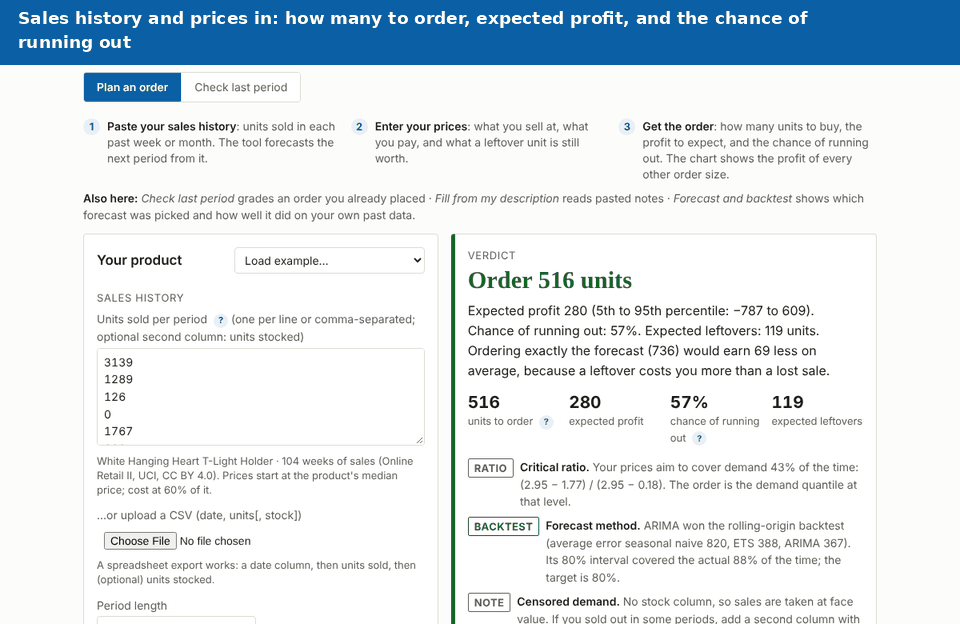
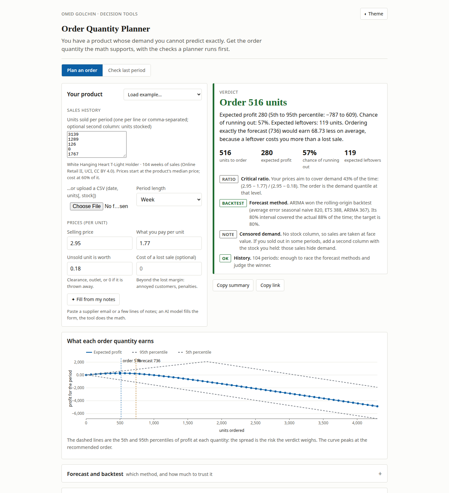

# Order Quantity Planner

For anyone who buys stock for a product whose demand they cannot predict exactly: paste the product's past sales and your prices, and get how many units to order, the profit to expect, and the chance of running out. Too few and you lose sales; too many and you are left with stock. The planner finds the order where those two risks balance for your margins, using a forecast chosen by testing it on the product's own past.





**Use it:** https://omidgolchin.github.io/order-quantity-planner/ (runs in your browser; nothing you type leaves it)

## What it does

Ordering for one period is a bet: order too few and you lose sales (and
customers), order too many and you eat the leftovers. How much of each
risk is worth taking depends on your margins. If a lost sale costs you
much more than a leftover, you should order well above the forecast;
if leftovers are expensive, below it.

The math behind it is the newsvendor model. Its critical ratio,

> (price − cost + goodwill) / (price − salvage + goodwill),

is the share of periods your order should cover: you order the amount
of demand that is not exceeded that often (that demand quantile: if
the ratio is 60%, the amount that demand stays at or below in 60% of
periods). This
planner builds the demand distribution from the product's own history:
a forecast method is chosen by rolling-origin backtest (seasonal naive
vs ETS vs ARIMA, lowest one-step error wins), its point forecast is
spread by its own residuals into scenarios, and every figure on the
page is computed from those scenarios, so the order, the expected
profit, the stock-out chance and the leftovers all describe the same
distribution.

History: the planner runs from 3 periods, races forecast methods from
20, and trusts the forecast fully from one seasonal cycle (26 weeks of
weekly data, or 12 months of monthly data) with at least 12 periods of
sales.

The page is one document in four numbered sections; the two jobs:

- **Plan an order** (sections 1–3) — the verdict ("Order 538 units"), expected profit
  with a 5–95% range, stock-out chance, expected leftovers, and a
  profit curve showing what every other order quantity would earn.
- **Check last period** (section 4) — enter what you ordered and sold; the planner
  grades it against the plan for the same demand, in expectation, so
  one lucky or unlucky period is not mistaken for a good or bad order.
- **Help where you need it.** Notes sit in the margin beside each section — inline on a phone — saying what each number is, why it matters and where to find it; and every technical term in the inputs and results has a **?** that opens a plain-language explanation.

Built-in examples come from the Online Retail II dataset (UCI, CC BY
4.0; see DATA_SOURCES.md): a steady seller, a strongly seasonal
product, an intermittent one, and a short-history product, plus
constructed examples for censored demand and a pricing slip. Your own
series can be pasted or uploaded as CSV; with a stock column, periods
where sales hit the stock level are treated as censored demand and the
upper tail is widened before the order is computed.

## Built-in checks

Every verdict shows the checks that produced it:

| Check | What it tests | When it is not OK |
|---|---|---|
| ORDER LEVEL (Critical ratio) | The critical ratio for your prices, and the amount of demand it points to: the level that demand stays at or below in that share of periods | Always INFO: it explains the order, it does not grade it |
| BACKTEST (Forecast method) | The winning forecast method's 80% interval coverage on this product's own history | WARN when coverage is far from 0.80: the spread is shakier than it claims |
| SPARSE (Intermittent demand) | Intermittent demand (30% or more empty periods) switches the distribution to a bootstrap of observed periods | INFO: the switch is disclosed, with the share of empty periods |
| SOLD OUT (Censored demand) | Whether sales hit the stock level often enough that the records understate demand | WARN when censored: the tail was widened; NOTE when no stock data was given |
| THIN (History) | Whether there is enough history to run the race at all | WARN below one seasonal cycle (26 weeks of weekly data, 12 months of monthly data) or with fewer than 12 non-empty periods |

## Design decisions

The full list, with reasoning, is in [DECISIONS.md](DECISIONS.md).
The ones that matter most:

- **The forecast is chosen per product, by backtest**, not by habit.
  On the 30 products in the research notes below, ETS won 14 times,
  ARIMA 13, seasonal naive 3; seasonal naive's intervals also covered
  only 0.73 of the time against a 0.80 target. A single default method
  would have been wrong most of the time.
- **Everything integrates over one scenario distribution.** The order
  (a quantile), expected profit, stock-out chance and leftovers are
  all computed from the same draws, so the page never mixes two
  different pictures of demand.
- **Censored demand is fixed before anything is computed.** Sales
  records understate demand exactly where it matters, in the upper
  tail, so the imputation happens first and the check stays visible
  on the verdict.
- **Check last period is graded in expectation.** One period is one
  draw; a good order can lose money. Realized profit is shown too,
  but the grade compares expected profits.
- **The browser races two methods, Python races three.** Built-in
  products are forecast offline with statsmodels (ARIMA included);
  a pasted series is raced in the browser between seasonal naive and
  Holt-Winters ETS. The page and this README say so, and the Python
  engine remains the reference the page's math is tested against.
- **No currency symbol.** The example data is priced in pounds, your
  prices are your own currency; amounts print as plain numbers.

Background: Arrow, Harris & Marschak (1951) for the newsvendor model;
Silver, Pyke & Peterson (1998) and Cachon & Terwiesch (2013) for the
critical ratio in practice; Hyndman & Athanasopoulos (2021) for ETS
and rolling-origin evaluation; Syntetos & Boylan (2005) for
intermittent demand; Kaplan & Meier (1958) for the censoring idea.

## Validation

- `tests/` — 28 tests, all passing (`pytest`), covering:
  - **Critical ratio vs brute force:** on three demand distributions
    (normal, uniform, lognormal; 20,000 integer draws each), the
    quantile order sits in the profit-maximizing plateau and earns
    the optimal expected profit.
  - **Profit formula by hand:** a two-point demand distribution whose
    expected profit (400) is computed in the test's comments.
  - **Forecast references:** the ETS forecast equals a direct
    statsmodels `ExponentialSmoothing` fit with the same
    configuration; the ARIMA forecast equals the AIC winner of a
    direct statsmodels grid.
  - **Backtest coverage by construction:** constant, linear and
    alternating series whose coverage and MAE are known exactly.
  - **Intermittent and censored handling:** a half-empty series goes
    to the bootstrap; a series capped by stock is detected and its
    mean restored by imputation.
  - **JavaScript vs Python:** the page's engine and the reference
    engine agree on the verdict for three fixed built-in products,
    on the profit curve, and on seasonal naive; every verdict state
    (good, warn twice over, bad) is reached by a constructed case.
  - **AI extraction: not yet run.** The test set
    (`assist/testset.json`, 20 notes with expected fields, including
    margin-as-percent, markup, pence and pasted tables) is scored by
    `node scripts/eval_assist.js` with any OpenAI key. The plumbing
    (prompt, parsing, quote checks) is covered by the test suite.

## What I learned

- The order is not the forecast. On the default product the critical ratio is 43%, so the plan orders 516 units against a forecast of 736; ordering the forecast earns about a quarter less in expectation. The price structure, not the forecast, decides which side of the median to stand on.
- No forecasting method wins everywhere. Across 30 products ETS won 14, ARIMA 13 and seasonal naive 3, so the method has to be chosen per product, by backtest.
- Intervals are estimates too. The model-based methods' 80% intervals covered 86–87% of actuals, seasonal naive's 73%; a planner that trusts the spread blindly orders off a distribution that is wrong in a known direction.
- One period proves little. A week that sells out or ends with a pile of stock is one draw; grading an order against its expected profit, not its realized one, is what separates a bad rule from a bad week.

## Research notes

**The forecast race on 30 products.** Each of the 30 best-selling
Online Retail II products (104 weekly observations each) was
backtested by rolling origin, 8 one-step origins, the same race the
tool runs:

| Method | Products won | Mean MAE | Mean 80% coverage (target 0.80) |
|---|---|---|---|
| ETS | 14 | 287.7 | 0.86 |
| ARIMA | 13 | 290.4 | 0.87 |
| Seasonal naive | 3 | 545.7 | 0.73 |

No method dominates, which is the point of racing them per product;
and both model-based methods' intervals run a little wide (0.86–0.87
against 0.80), a reminder that the spread is an estimate too. Full
table: `results/backtest_by_product.csv`.

**The earlier classic backtest.** The build this tool replaces
(demand-risk-simulator, v2 of the program) ran seasonal naive with
bootstrap intervals over 4-week horizons on the same 30 products, plus
an order/profit simulation at a frozen price design. Its table is
kept at `results/backtest_classic.csv` for comparison; its LLM
forecasting comparison was not carried into this tool, per the
product rule that tools ship without studies inside them.

## Run it

```bash
make setup   # python3 -m venv .venv && pip install -r requirements.txt
make test    # pytest: formula, forecast, agreement and plumbing tests
make data    # rebuild docs/data/products.js from data/weekly_top30.csv
make serve   # http://localhost:8000 — the planner, from docs/
```

## Layout

```
docs/     the page: index.html, app.js, newsvendor.js (engine),
          forecast.js (browser forecaster), assist-config.js,
          data/products.js (built-in products, generated)
src/      orderplan/: the reference engine in Python
data/     weekly_top30.csv, the derived dataset (CC BY 4.0)
scripts/  build_data.py, eval_assist.js
assist/   the AI-assist test set (20 notes)
tests/    pytest suite
results/  backtest tables and the method-race summary
```

## Limitations

- One period, one product, no lead time, no replenishment. This is
  the single-period bet, not an inventory system.
- A pasted series is raced with two methods (no ARIMA in the
  browser); its intervals come from residuals, not a full
  probabilistic model.
- The profit range is the spread across demand scenarios at your
  prices; it does not include price or cost uncertainty.
- Censoring is detected only when stock data is provided, and the
  imputation assumes demand in a capped period looked like the
  observed periods that reached at least that level.
- Example products' default prices (cost = 60% of price, salvage =
  10% of cost) are starting values for the fields, not the retailer's
  actual margins.

## References

- Arrow, K. J., Harris, T. & Marschak, J. (1951). Optimal inventory
  policy. *Econometrica*, 19(3), 250–272.
- Cachon, G. & Terwiesch, C. (2013). *Matching Supply with Demand*
  (3rd ed.). McGraw-Hill. (Newsvendor model and critical ratio.)
- Hyndman, R. J. & Athanasopoulos, G. (2021). *Forecasting: Principles
  and Practice* (3rd ed.). OTexts. (ETS, ARIMA, rolling-origin
  evaluation.)
- Kaplan, E. L. & Meier, P. (1958). Nonparametric estimation from
  incomplete observations. *JASA*, 53(282), 457–481.
- Silver, E. A., Pyke, D. F. & Peterson, R. (1998). *Inventory
  Management and Production Planning and Scheduling* (3rd ed.).
  Wiley.
- Syntetos, A. A. & Boylan, J. E. (2005). The accuracy of intermittent
  demand estimates. *International Journal of Forecasting*, 21(2),
  303–314.
- Chen, D. (2012). *Online Retail II* [Dataset]. UCI Machine Learning
  Repository. https://doi.org/10.24432/C5CG6D (CC BY 4.0.)

## License

MIT — see [LICENSE](LICENSE). The derived dataset in `data/` is CC BY
4.0 (UCI), attributed in [DATA_SOURCES.md](DATA_SOURCES.md).
